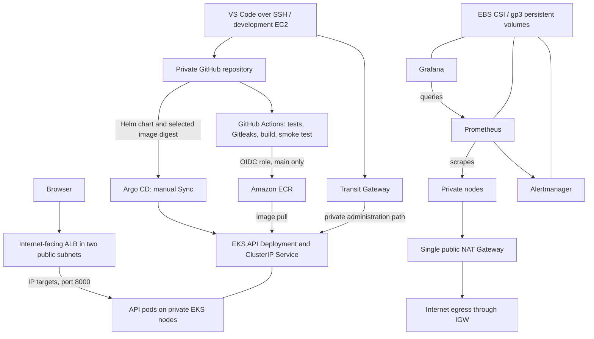

# Project 03: Enterprise CI/CD Automation Platform

A single-account AWS learning project that delivers a Python API through GitHub Actions, ECR, Helm and Argo CD to EKS. AWS infrastructure was built manually to learn networking and IAM. Argo CD synchronization remains manual.

## Status

Core implementation complete. The ALB `/health` endpoint returned `{"status":"healthy"}` and Grafana opened successfully. The latest monitoring configuration commit/PR and load-test results still need confirmation. This repository documents a lab, not a production readiness claim.

## Architecture



The default VPC hosts the development EC2. Transit Gateway connects it to the project VPC. The EKS API is private. An internet-facing ALB accepts HTTP requests and forwards them to private pod IPs. The Service identifies backend pods; with IP targets, the ALB data path reaches the pods directly. NAT provides outbound connectivity and is not in the browser-to-API path.

## Implemented stack

| Area | Tools and services |
|---|---|
| Development | Ubuntu Linux, VS Code Remote SSH, Git/GitHub, Python, Bash |
| CI | GitHub Actions, unit tests, Gitleaks, Docker build and smoke tests |
| Image delivery | ECR, GitHub OIDC, IAM role, immutable deployment digest |
| Kubernetes | EKS managed node group, VPC CNI, CoreDNS, kube-proxy, Pod Identity |
| Delivery | Helm, Argo CD with manual Sync |
| Ingress | AWS Load Balancer Controller, public Application Load Balancer |
| Networking | Two VPCs, Transit Gateway, public/private/TGW subnets, IGW, NAT |
| Monitoring | kube-prometheus-stack: Prometheus, Grafana, Alertmanager |
| Storage | EBS CSI driver, encrypted gp3 StorageClass and persistent claims |

## Resource reference

Historical identifiers below must be checked against the live inventory before cleanup. Public IPs and pod/node IPs may change.

| Resource | Recorded value |
|---|---|
| AWS account / region | `036706657723` / `ap-south-1` |
| GitHub repository | `BhanuVardhan24/Project--03` (private) |
| Development EC2 | `i-02bd871cfe723a31a` |
| Dev private / Elastic IP | `172.31.4.141` / `43.205.158.134` |
| Dev root disk | `vol-036934aa53bb60556`, originally 15 GiB |
| Dev Elastic IP allocation | `eipalloc-0e4238fbedbd0cc69` |
| Default/dev VPC | `vpc-0793d4912fdc45391`, `172.31.0.0/16` |
| Dev subnet | `subnet-03722f80da14e1426`, `ap-south-1b` |
| Project VPC | `vpc-0053bf7f247c7ce83`, `10.30.0.0/16` |
| Public a / b | `subnet-07a78536ace1f49f7` / `subnet-09b8f2268f78f3788` |
| Private a / b | `subnet-0c090078c81e179c7` / `subnet-02fa1e4cb1cc14054` |
| TGW a / b | `subnet-0aa71957dc9e6bd6a` / `subnet-0683298a0c1897112` |
| Public / private / TGW route tables | `rtb-07f57793c3873e161` / `rtb-08d0a2e8e37f68e8e` / `rtb-0065787ff3ab3248f` |
| Internet Gateway | `igw-0e60209071de90226` |
| NAT Gateway | `nat-001adf9eeda624dae` |
| Transit Gateway | `tgw-05019e12d899d1cfb` |
| Project TGW attachment | `tgw-attach-0f6e80d9640ca0469` |
| EKS cluster / node group | `project03-eks` / `project03-workers` |
| Cluster security group | `sg-00c6d48d150595d79` |
| Service CIDR | `10.100.0.0/16` |
| ECR repository | `036706657723.dkr.ecr.ap-south-1.amazonaws.com/project03-api` |
| ALB | `project03-api-alb`; retrieve current DNS from inventory |

## Delivery workflow

1. Create a feature branch and push changes.
2. Open a PR into `main`. Tests, secret scanning, image build and smoke tests run.
3. Merge after successful checks. The main workflow assumes the AWS role using OIDC and pushes the tested image to ECR. AWS publishing is skipped for PRs.
4. Copy the successful workflow's image digest into `charts/project03-api/values.yaml` through a reviewed PR.
5. Merge, then Refresh and inspect App Diff in Argo CD. Click Sync manually.
6. Verify rollout health and the ALB `/health` response.

Argo CD watches Git, not new ECR images. Updating application code alone does not change the deployed image digest. The current workflow may also build an image for configuration-only merges.

```yaml
image:
  repository: 036706657723.dkr.ecr.ap-south-1.amazonaws.com/project03-api
  digest: "sha256:ACTUAL_64_CHARACTER_HASH"
```

The template combines repository and digest with `@`. Do not paste the complete ECR reference into the digest field.

## Configuration layout

```text
.github/workflows/ci.yml
app/main.py
tests/
Dockerfile
charts/project03-api/
  Chart.yaml
  values.yaml
  templates/deployment.yaml
  templates/service.yaml
  templates/ingress.yaml
gitops/platform/
  argocd-values.yaml
  aws-load-balancer-controller-values.yaml
  gp3-storageclass.yaml
  monitoring-values.yaml
```

Argo CD manages the API chart at `charts/project03-api` in namespace `project03`. Platform components were installed directly using Helm, with configuration recorded in Git. Committing platform values does not cause the API Argo CD application to deploy them.

## Access and verification

Run from the development EC2 with valid AWS authentication and cluster access:

```bash
aws sts get-caller-identity
kubectl get nodes
kubectl get pods -n project03
kubectl rollout status deployment/project03-api -n project03 --timeout=180s
kubectl get ingress -n project03
```

Use `http://ALB_DNS/health` for the public health endpoint. HTTPS and a custom domain are not configured.

Argo CD, in a dedicated terminal:

```bash
kubectl port-forward -n argocd svc/argocd-server 8081:443
```

Forward port 8081 through VS Code and open `https://localhost:8081`. Use your existing admin credentials. The initial-admin secret is only relevant if it still exists and the password has not changed.

Grafana, in a separate terminal:

```bash
kubectl port-forward -n monitoring svc/monitoring-grafana 3000:80
```

Forward port 3000 and open `http://localhost:3000`. Credentials remain in Kubernetes Secrets, never in Git or this document.

## Monitoring

The requested configuration uses one Prometheus replica, two-day retention, a 3 GB metrics retention target and a 5 GiB disk. Grafana requests 2 GiB and Alertmanager 1 GiB. Confirm actual claims with `kubectl get pvc -n monitoring`.

The gp3 class uses encryption, `WaitForFirstConsumer`, expansion support and `Delete` reclaim policy. EBS volumes are AZ-bound. Single replicas and one NAT are deliberate lab tradeoffs, not full high availability.

Grafana's Kubernetes namespace/pod dashboards show CPU and memory. API request-rate and latency metrics are not instrumented. Alertmanager is installed, but a custom API availability alert and external notification destination have not been configured.

## Load test

ApacheBench stages were provided at concurrency 5, 20 and 50 for up to 60 seconds each. Results have not been supplied or validated. Do not claim a throughput figure.

```bash
export API_URL="http://ACTUAL_ALB_DNS/health"
ab -t 60 -n 1000000 -c 5 -s 10 "$API_URL"
```

Run higher concurrency only after reviewing failures, non-2xx responses, p95/p99 latency and pod health. This measures a small health endpoint, including connection overhead, not a database-backed workload.

## Troubleshooting lessons

| Symptom | Finding and resolution |
|---|---|
| Nodes NotReady, CNI not initialized | Corrected the VPC CNI Pod Identity association and restarted aws-node |
| Argo CD Synced but Degraded | Sync reflects desired configuration, not application health |
| InvalidImageName | Corrected the repository/digest format in Git and manually synced |
| Two CoreDNS pods | Expected redundant DNS replicas |

Useful diagnostics:

```bash
kubectl get events -n project03 --sort-by=.metadata.creationTimestamp
kubectl describe ingress project03-api -n project03
kubectl logs -n kube-system deployment/aws-load-balancer-controller --tail=60
kubectl get pods,pvc -n monitoring
```

## Deliberate exclusions and deferred work

- Terraform: skipped for manual AWS practice.
- Argo Rollouts and rollback exercise: skipped by choice.
- Argo CD automatic Sync: not part of this project.
- Trivy: removed after repeated findings/failures, not a passing security gate.
- CloudWatch/Fluent Bit logging, SonarQube, Inspector and Secrets Manager/External Secrets: not implemented as part of the demonstrated workflow.
- PostgreSQL, Redis and Ansible: broader Super 20 stack tools, not demonstrated in this API lab.
- `/version` troubleshooting was deferred. Do not claim it passed the final public-access test.

## Inventory and cleanup

Run the accompanying read-only CloudShell inventory before deleting anything. It records AWS metadata, errors and ownership candidates. Also collect Kubernetes/Helm evidence from the dev EC2 because the private EKS API is usually unreachable from standard CloudShell.

The report is not a deletion manifest. Preserve shared/default VPC infrastructure, the existing GitHub OIDC provider, unrelated IAM roles and any other workloads. Confirm ownership for EFS resources: an installed EFS driver alone does not prove that an EFS file system belongs to this project.

Cleanup planning order: remove controller-managed Ingress/ALB and application resources while controllers still run; handle monitoring claims/disks and backups intentionally; remove workers and cluster; then remove project network dependencies, NAT/EIPs and TGW attachments; remove project IAM/ECR resources after review; handle the development EC2 and its disk/IP last. Verify residual volumes, snapshots, IP allocations and log groups afterwards.

No teardown has been performed. Stopping EC2 alone does not stop EKS, NAT, ALB, TGW, disk or public IPv4 charges.

## References

- [AWS EKS documentation](https://docs.aws.amazon.com/eks/latest/userguide/what-is-eks.html)
- [AWS Load Balancer Controller](https://kubernetes-sigs.github.io/aws-load-balancer-controller/latest/)
- [Argo CD](https://argo-cd.readthedocs.io/en/stable/)
- [Monitoring Helm chart](https://github.com/prometheus-community/helm-charts/tree/main/charts/kube-prometheus-stack)

Recorded from the project walkthrough on 29 October 2026. Run the live inventory for current state. Remove account identifiers and public IPs before publishing this document publicly if desired.
